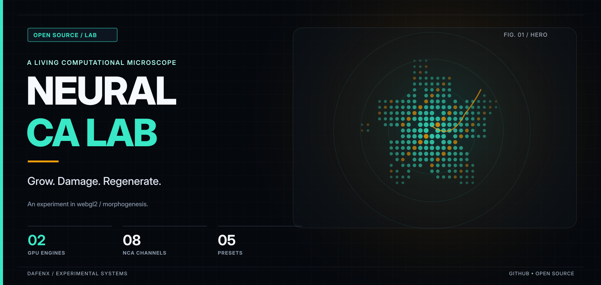
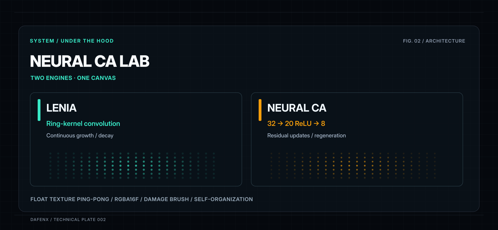

<p align="center">
  
</p>

<p align="center">
  <a href="https://github.com/Dafenxz0/neural-ca-lab/actions/workflows/ci.yml"></a>
  <a href="https://dafenxz0.github.io/neural-ca-lab/"></a>
</p>

# Neural-CA Lab

### A computational microscope for artificial life.

A zero-build WebGL2 experiment bringing together **Lenia continuous cellular automata** and an **8-channel self-healing neural cellular automaton**. Paint cells, slice structures apart, vary the growth rules, and watch local updates create global behavior.

<p align="center"><a href="https://dafenxz0.github.io/neural-ca-lab/"><strong>OPEN THE LIVE LAB</strong></a></p>



## Two different models of emergence

| | Lenia | Neural CA |
| --- | --- | --- |
| State | Continuous scalar activity | 8 channels in two RGBA16F textures |
| Update | Multi-shell ring convolution + Gaussian growth | Identity, Sobel X/Y and Laplacian features → `32 → 20 → 8` MLP |
| Behavior | Mobile solitons and wave colonies | Learned regeneration after damage |
| Examples | Orbium, Hydrogeminium, Synapsia | Planarian, Cryo-Lotus |

Both engines run GPU fragment shaders, using **ping-pong floating-point textures** to read the previous state and write the next state. The Neural CA uses multiple render targets for its 8 channels.

## Explore the laboratory

**[Open Neural-CA Lab →](https://dafenxz0.github.io/neural-ca-lab/)**

1. Pick one of the **five presets** and start the simulation.
2. Use **Seed / Spawn** to add new activity.
3. Switch to **Slice / Damage**, remove part of an organism and observe what happens.
4. Change the growth center `μ`, width `σ`, step size `dt`, brush radius and palette.

| Shortcut | Action |
| --- | --- |
| `Space` | Pause / resume |
| `S` | Single step |
| `R` | Reset |
| `H` | Toggle help |
| `1`–`5` | Choose specimen preset |
| `[` / `]` | Adjust brush radius |

## The rules underneath

### Lenia: convolution and growth

The state `A(x,y)` is updated from a neighborhood potential `U = K * A`, where `K` is a normalized radial kernel:

$$
G(U;\mu,\sigma)=2\exp\left(-\frac{(U-\mu)^2}{2\sigma^2}\right)-1,
\qquad A_{t+dt}=\operatorname{clamp}(A_t+dt\,G(U),0,1).
$$

### Neural CA: perceive, update, repair

Each active cell perceives 32 local features using four stencil families: identity, horizontal/vertical Sobel and 9-point Laplacian. A trained `32 → 20 ReLU → 8` network predicts a residual state update. Stochastic updates use `p = 0.5`; damage augmentation during training is what enables the self-healing demonstrations.

## Run locally

This is a static ES-module project. A local web server is sufficient.

```bash
git clone https://github.com/Dafenxz0/neural-ca-lab.git
cd neural-ca-lab
npm run check
npm test
npx serve .
```

Open the local URL printed by your server. Your browser needs **WebGL2** and floating-point render-target support for the GPU simulation.

## Code map

| File | Responsibility |
| --- | --- |
| [`src/gl.js`](src/gl.js) | WebGL2, textures and framebuffer ping-pong |
| [`src/shaders.js`](src/shaders.js) | Lenia / NCA / brush / display shaders |
| [`src/math.js`](src/math.js) | CPU reference, kernels, weight validation |
| [`src/nca_weights.js`](src/nca_weights.js) | Stored weights for trained NCA presets |
| [`src/presets.js`](src/presets.js) | Specimens and toroidal seeds |
| [`src/main.js`](src/main.js) | Simulation control, input and HUD |

**Note:** not every damage event is guaranteed to regenerate; the response depends on specimen, location, amount of damage and parameters. The vector art is a stylized illustration, not a simulation capture.
